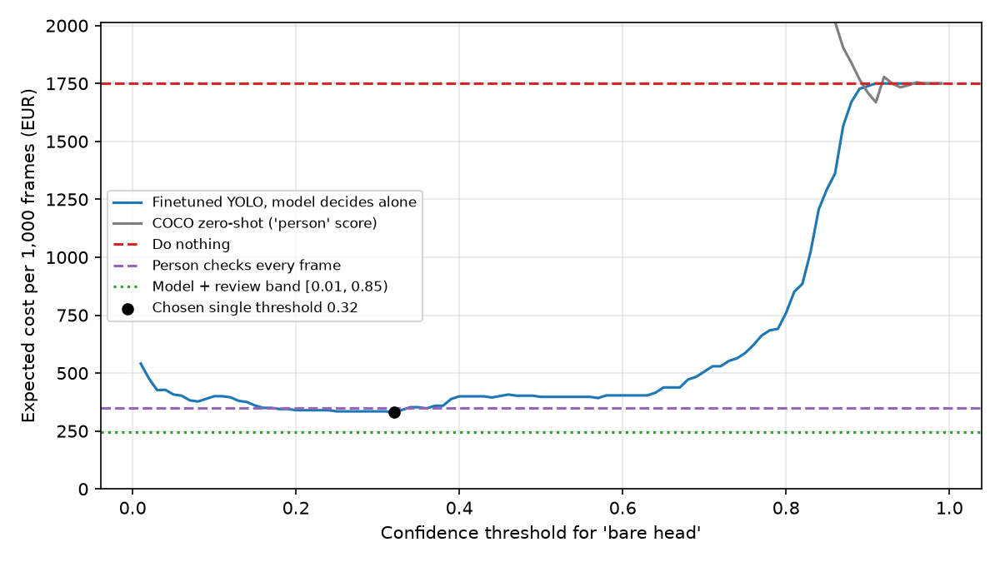

# Assignment 2 Report

- **Name**: Ainhoa Olaechea
- **Student ID**: 18680
- **Email**: aolaechea.ieu2022@student.ie.edu
- **Group**: BBADBA 5A

## Business problem, and the cost of being wrong

**The decision.** A large building under construction in Madrid has about 150 workers across 10 active floors, with two fixed cameras per floor. Spanish law requires a "recurso preventivo" (which is an on-site safety person) for this kind of work, and on this site each floor has one. Today that person finds workers without a helmet by walking the floor and looking. The model looks at one camera frame per minute and routes each frame to one of three outcomes:

| Outcome | What happens |
|---|---|
| **PASS** | Nothing. |
| **REVIEW** | A safety technician in the site office looks at the frame on a screen and decides. |
| **FAIL** | The floor's *recurso preventivo* gets an alert and walks over to the worker. |

The positive class is a frame that shows at least one worker without a helmet (at least one `head` box). A person always makes the final call. The model only decides who has to look at what.

**What each mistake costs.**

- **False alarm (FP), €3.** The *recurso preventivo* stops what they are doing, walks over and finds everyone wearing a helmet. That is about 5 minutes of a €25/h person (≈ €2) plus about 2 minutes of the worker's time (≈ €1). It can be inconvinient, and if it happens too often people start ignoring alerts. 
- **Missed bare head (FN), €35.** Most uncorrected violations end with nothing happening, so the cost is an expected value:
  - Injury: I assume 1 in 1,000 uncorrected violations ends in a head injury with sick leave. The company bears about €30,000 (salary during leave, investigation, insurance, and possible surcharges when safety measures were missing). Expected cost: **€30**.
  - Fine: I assume 1 in 2,000 is seen by a labour inspector and fined about €10,000. Not ensuring PPE is used is a grave PRL infraction, fined €2,451–€49,180. Expected cost: **€5**.
- **Caught bare head (TP), €3.** It costs the same walk-over as a false alarm, but it removes the €35 risk.
- **Correct "all fine" (TN), €0.**
- **Human review, €0.20 per frame.** A technician needs about 30 seconds per frame at €24/h, because most heads are tiny and the reviewer has to zoom in (see the dataset section).

**The asymmetry.** A miss costs about **12 times** a false alarm (€35 vs €3). That is why the system should lean towards flagging. It is also why accuracy alone is misleading a system that never raises an alarm can still achieve 80% accuracy on the test set while failing to detect a single case.

## Dataset

- **Roboflow Universe:** workspace `joseph-nelson`, project `hard-hat-workers`, **version 5** (`raw_HeadHelmetClasses`): https://universe.roboflow.com/joseph-nelson/hard-hat-workers
- **License:** Public Domain. The original data comes from Northeastern University (China).
- **One image:** a photo of a real worksite with one or more workers. Each visible head is boxed either as `helmet` (wearing a hard hat) or `head` (no hard hat).
- **Why version 5:** it holds the raw, unaugmented images (so the test images look like real camera frames), it has a proper 70/20/10 train/valid/test split (versions 1–3 only have train/test), and it drops the `person` class. My decision only needs "is there a head without a helmet?", so `head` vs `helmet` is exactly the contrast that matters.

This dataset is well suited to the task because it directly captures the information needed for safety monitoring, whether each individual person is wearing a helmet. Unlike a general person detector, it can distinguish between helmeted and unhelmeted individuals, a limitation illustrated by the COCO baseline discussed below.

## What the dataset's composition implies

| Split | Images | `head` boxes | `helmet` boxes | Images with ≥1 bare head | Empty images |
|---|---|---|---|---|---|
| Train | 4,916 | 4,612 | 13,919 | 911 (18.5%) | 0 |
| Valid | 1,413 | 1,339 | 3,913 | 256 (18.1%) | 0 |
| Test | 706 | 726 | 1,915 | 140 (19.8%) | 0 |

| Box size (share of image area) | `head` | `helmet` |
|---|---|---|
| Median | 0.6% | 0.8% |
| Tiny (<1%) | 72% | 56% |
| Small (1–5%) | 27% | 35% |
| Medium or large (>5%) | 1% | 10% |

What this implies:

1. **The positive class is the minority, about 1 head per 3 helmets.** However the training set contains 4,612 annotated heads, providing a reasonable amount of data for the model to learn from. The minority class is sufficiently represented in order to support training. 
2. **The image level business metric is based on only 140 test images.** Recall at image level is calculated across these 140 images, meaning each missed image changes the result by approximately 0.7 percentage points. Missing seven additional images would reduce recall by around five percentage points. Therefore, a reported recall of 93% should be interpreted with caution, with an approximate range of 88–97% illustrating the uncertainty. The box level metrics, calculated across 726 test heads, are based on more individual observations.
3. **Most heads occupy very little of the image.** Approximately 72% cover less than 1% of the image area, indicating that workers are often relatively far from the camera. This makes detection more challenging and supports retaining the full 640 pixel input resolution. Small detections also affect the assumed human review time, reviewers may need to zoom in to verify predictions, so I use 30 seconds per frame rather than five seconds in the cost model.
4. **The test set does not fully represent real world operating conditions.** All test images contain workers, and approximately 20% include an unhelmeted head. In contrast, real workplace cameras may capture empty areas, breaks and teams where most workers comply with helmet requirements. For the cost analysis, I therefore assume a 5% production base rate rather than the 20% observed in the test set, and adjust the results accordingly. This assumes that the model's error rates remain comparable across settings, the different proportions of positive and negative frames are accounted for separately.
5. **The available data limits what can be concluded about performance in production.** The test set does not include empty frames, night time conditions, rain or alternative camera angles. Consequently, the false alarm rate has only been measured on images containing helmeted workers, not on empty scenes. The rate could differ substantially in those conditions, and its actual value remains unknown until tested.
6. **The training, validation and test splits appear broadly consistent.** Positive class proportions range from 18% to 20%, and the distributions of bounding box sizes are similar. This suggests that the validation set provides a reasonable basis for monitoring training and selecting the stopping point, although it does not establish that either split fully represents production conditions.

## Finetuning and baselines

**Model and setup.** Object detection with `yolo11n`, finetuned from its COCO-pretrained checkpoint. I chose detection because the decision depends on any bare head anywhere in a crowded frame, and a whole-image classifier would struggle to spot one small head among many helmets.

- **Trained on** Google Colab, NVIDIA Tesla T4 GPU
- **Settings:** up to 50 epochs, early-stopping patience 15, image size 640, batch 16, seed 0, Ultralytics default augmentation, optimizer chosen automatically (AdamW)
- **Pipeline:** `uv run python main.py train` downloads the data, trains, evaluates, and writes `weights/best.pt` and `outputs/`

**From boxes to a decision.** The frame's score is the highest `head` confidence anywhere in the frame. Thresholds are applied to that score.

**Results on the same 706-image test split**, image-level decision at threshold 0.5:

| Model | Caught (TP) | False alarms (FP) | Missed (FN) | Correct OK (TN) | Accuracy | Precision | Recall |
|---|---|---|---|---|---|---|---|
| **Finetuned yolo11n** | 121 | 6 | 19 | 560 | **96.5%** | **95.3%** | **86.4%** |
| COCO yolo11n zero-shot (`person` score) | 140 | 531 | 0 | 35 | 24.8% | 20.9% | 100% |
| Trivial: predict nothing | 0 | 0 | 140 | 566 | 80.2% | 0% | 0% |

At box level, the COCO model achieves AP = 0 for both classes because it does not include head or helmet among its detection categories. Instead, it can only identify people, flagging 671 of the 706 frames. This is insufficient for the task because detecting a person does not indicate whether they are wearing a helmet. The trivial baseline further illustrates the limitations of accuracy as a performance metric, despite achieving 80% accuracy, it fails to detect any unprotected workers.

The fine tuned model substantially outperforms both baselines. This improvement is expected, as the zero shot model is not trained to recognise helmets as a specific detection class and therefore cannot reliably distinguish between workers who are wearing helmets and those who are not.

## Per-class evaluation and failure modes

**Detection metrics on the test split** (positive class: `head`):

| Class | Precision | Recall | AP50 | AP50-95 |
|---|---|---|---|---|
| **head** (no helmet) | 0.943 | 0.929 | 0.966 | 0.678 |
| helmet | 0.957 | 0.940 | 0.983 | 0.688 |
| **all** | — | — | **0.975** | **0.683** |

- The overall performance is driven largely by the helmet class. It contains 2.6 times as many annotated boxes and is slightly easier to detect. The head class performs less well, despite being the more important class for the safety use case. Its AP50 is 0.966, compared with 0.983 for helmet. Although the difference is relatively small, performance on this class has a greater impact on the estimated business cost.
- The difference between AP50 (0.97) and AP50-95 (0.68) indicates limitations in bounding box precision. The model generally detects objects successfully, but the predicted boxes do not always match their exact locations and dimensions closely. This is particularly challenging when objects are only a few dozen pixels wide, as small positional errors can substantially affect IoU at stricter thresholds. For the intended application, however, identifying whether an unprotected head is present matters more than precisely outlining it.

**Head vs helmet confusion** (box level, from the Ultralytics confusion matrix):

| | true head | true helmet |
|---|---|---|
| predicted head | 706 | 7 |
| predicted helmet | **20** | 1,901 |

The model incorrectly classifies a bare head as a helmet **20 times**, compared with seven errors in the opposite direction. This asymmetry is important because the former error can cause a genuine safety violation to go undetected, whereas the latter is more likely to trigger an unnecessary alert. 

The confusion matrix generated by Ultralytics includes predictions for all bounding boxes down to a confidence threshold of 0.001. As a result, its background row and column include thousands of low confidence detections that would not necessarily trigger an alert in practice. For this reason, I assess false alarms using the image level decision rather than relying directly on the background counts in the box level confusion matrix.

**Where it breaks** (image level, at my chosen single threshold of 0.32):

- **Missed detections (10 out of 140 frames containing a bare head):** Most misses occur when a single, small bare head is present. Nine of the ten missed frames contain exactly one bare head, despite single head frames accounting for only 36 of the 140 positive frames. In images with multiple bare heads, the model generally detects at least one. This suggests that isolated workers at a distance are particularly challenging to detect, which is a concern because these cases may also be difficult for someone monitoring the site manually.

- **False alarms (13 out of 566 frames):** These frames contain no labelled bare heads but still produce a head detection score between 0.35 and 0.85. I have not manually reviewed each case, so the underlying causes remain uncertain. Possible explanations include caps, hoods or hair being mistaken for a bare head, as well as unprotected heads that were not annotated in the dataset. Three false alarms have scores above 0.83, indicating that even relatively confident predictions are not always reliable. This supports using a high threshold of 0.85 to classify a frame as a failure, while directing intermediate confidence cases to human review.

## Cost matrix and operating point

**Cost matrix** (per frame, from the business section):

| | True: bare head | True: all helmets |
|---|---|---|
| **Model alerts** | TP: €3 | FP: €3 |
| **Model passes** | FN: €35 | TN: €0 |
| **Sent to review** | €0.20 + €3 (confirmed and acted on) | €0.20 |

**Base rate: 5%.** I assume that 5% of frames in a real production environment contain a bare head, compared with 19.8% in the test set. The rationale for this adjustment is explained in the dataset section. I use the test set hit rate on frames containing bare heads and false alarm rate on frames without them, then adjust these rates to reflect the assumed 5% production base rate across 1,000 frames. The estimated daily volume is **10,800 frames**, based on 20 cameras capturing one frame per minute over nine hours.

**Threshold sweep.** I evaluated thresholds from 0.01 to 0.99 in increments of 0.01, calculating the expected cost per 1,000 frames at each threshold. The results are saved in `outputs/cost_sweep.csv` and `outputs/cost_curve.png` and are also available in the dashboard.

- **The lowest cost threshold for fully automated decisions is 0.32**, with an estimated cost of **€330 per 1,000 frames**. At this threshold, the model detects 46.4 bare head cases, generates 21.8 false alarms and misses 3.6 cases per 1,000 frames.
- **The cost curve remains relatively flat between approximately 0.16 and 0.38.** Thresholds within this range produce costs within around €30 of the minimum. Therefore, the precise optimum of 0.32 should not be interpreted as uniquely best; a threshold in the broader range of 0.2–0.35 offers similar performance. Above 0.65, costs rise sharply as more missed detections accumulate, given the assumed €35 cost per miss.
- **The zero shot COCO model does not offer a meaningful improvement over the simplest baseline.** Its performance never approaches that of the fine tuned model and, at best, is comparable to taking no action.

**Sensitivity: what would change the answer** (`outputs/sensitivity.csv`):

| Base rate | Miss costs | Best single threshold | Model + review cost | Do nothing | Person checks all |
|---|---|---|---|---|---|
| 2% | €35 | 0.57 | €108 | €700 | €260 |
| **5%** | **€35** | **0.32** | **€247** | **€1,750** | **€350** |
| 5% | €15 | 0.57 | €200 | €750 | €350 |
| 5% | €100 | 0.32 | €386 | €5,000 | €350 |
| 20% | €35 | 0.08 | €907 | €6,930 | €794 |

- **The assumed cost of a missed detection has the greatest influence on the recommendation.** If a miss costs more than approximately **€83**, having a person review every frame becomes cheaper than using the model with human review for uncertain cases. However, this would require around 12 reviewers instead of two. Conversely, if the cost of a miss falls below approximately **€1.50**, taking no action becomes the least expensive option under the model's assumptions. These results suggest that the proposed system is economically attractive across a broad range of plausible miss costs, with the human-review approach remaining preferable when the cost of a miss is approximately €2–€83.
- **The assumed production base rate also affects the optimal threshold.** When bare head cases become less frequent, a greater proportion of alerts are false positives, making a higher threshold more cost effective. For example, the optimal threshold rises to 0.57 when the base rate is 2%. Conversely, when the prevalence increases to 20%, closer to that observed in the test set, the optimal threshold falls to 0.08.

## What a person still has to check

**Chosen thresholds** (the pair that minimises expected cost, found by sweeping both):

| Score (highest `head` confidence) | Outcome |
|---|---|
| < **0.01** | **PASS**: the model sees no bare head at all |
| **0.01 – 0.85** | **REVIEW**: a technician checks the frame |
| ≥ **0.85** | **FAIL**: alert the floor's *recurso preventivo* |

Per 1,000 production frames:

| True situation | PASS | REVIEW | FAIL |
|---|---|---|---|
| Bare head (50) | 2.1 | 33.6 | 14.3 |
| All helmets (950) | 842.6 | 107.4 | 0 |

**Review load.**

- **14.1% of frames** go to review: 0.141 × 10,800 = **1,523 frames/day**.
- At 30 s each, that is **12.7 hours of checking per day**.
- At about 7.5 productive screen hours per person per shift, that needs **2 reviewers**.

**Is this realistic?** For a site of this size, the staffing assumption is possible. Two junior safety technicians based in the site office could manage the review process, particularly on a large construction site where safety monitoring is already part of normal operations. However, two considerations remain:

- **Most reviewed frames do not contain a safety violation.** Approximately three quarters of the reviewed frames are compliant (107 out of 141). This means reviewers spend much of their time checking frames that do not require intervention, which could lead to fatigue and reduced attention over time.
- **The workload may be overstated because repeated frames are counted separately.** Multiple alerts may relate to the same worker appearing in consecutive frames. Grouping alerts from the same camera within a short time window could reduce the number of separate reviews required and make the staffing estimate more realistic.

**Against the alternatives** (expected cost; per year = 230 working days):

| Policy | € per 1,000 frames | € per day | € per year | People needed |
|---|---|---|---|---|
| Do nothing | 1,750 | 18,900 | 4.35 M | 0 |
| A person checks every frame | 350 | 3,780 | 869 k | **12 reviewers** (90 h/day) |
| Model alone (threshold 0.32) | 330 | 3,561 | 819 k | 0 |
| **Model + human review (0.01 / 0.85)** | **247** | **2,665** | **613 k** | **2 reviewers** |

Model + review is the cheapest option. It costs **7× less than doing nothing**, **25% less than the model alone** (the review band catches most of the model's misses), and needs **6× fewer people** than checking everything by hand. The absolute euro figures are inflated because each frame is costed independently while one violation spans many frames, so I trust the ranking of the policies more than the totals.

## Limitations & next steps

1. **No empty or "normal day" frames in the test set.** The false-alarm rate is measured on crowded, helmet-heavy frames. Next step would be to record a week of footage from the real cameras, label a random sample, and remeasure the false alarm rate and the 5% base rate, the two numbers my costs rest on most.
2. **Cost assumptions are estimates, not data.** The injury probability (1 in 1,000) and the inspection probability (1 in 2,000) drive the miss cost. Next step would be to use the contractor's own incident and inspection history, and keep the sensitivity table in the dashboard so the thresholds can be rechosen when the numbers change.
3. **Frames are not independent.** One worker without a helmet appears in many consecutive frames. Next step would be to track workers across frames and cost per violation episode instead of per frame. That would also cut the review load.
4. **The model misses lone, far-away heads.** Therefore the next step would be to train at a larger image size (for example 960–1280 px) or try `yolo11s`, and add more examples of single small workers.
5. **Only 140 bare-head test frames.** Image level recall has a margin of about ±5 points. The next step should be to evaluate on a larger, site specific test set before relying on the exact thresholds.
6. **Reviewers are assumed to be always right.** The next step would be to measure the reviewers' own error rate in a pilot and add it to the cost model.
7. **The 13 false alarms were not inspected visually.** The next step would be to look at them to see whether they are model errors (caps, hoods) or missing labels. If they are missing labels, the model is better than measured.

## Generative AI use disclosure

- **Dataset search:** I evaluated candidate Roboflow datasets against the assignment requirements, using Claude as a tool to support the comparison process.
- **Code and implementation:** I developed and debugged `explore_data.py`, `train.py`, `costs.py` and `app.py`, with Claude’s assistance where needed, including troubleshooting the Colab and Codespaces environments.
- **Cost assumptions:** I established and reviewed the cost figures, base rate and staffing assumptions, using Claude to help develop and assess the rationale behind them.
- **Report writing:** I prepared the report based on the actual outputs of my pipeline, using Claude to help structure and refine the wording. I reviewed the final text and can explain the methodology, results and decisions made throughout the project.
- **Results and reproducibility:** All numerical results reported come from my own training run and the corresponding files in `outputs/`.